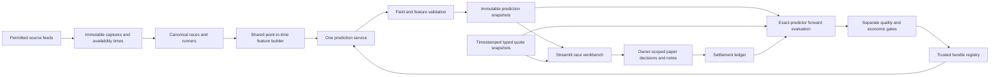

# Prioritized delivery roadmap

## Recommended sequence

### Delivery 1 — Correctness and identity

**Indicative duration:** 3–5 weeks for one developer, with shared work across items. Build B01/B05/B06/B07 first; repair D05/F01/F05 and M02/M03. Add fixture regressions alongside these changes. Label incomplete or unsupported outputs as withheld. Do not wait for a complete new backend before fixing the probability labels and minimum-stake behavior.

**Exit criteria:** stable race/horse/runner IDs; no scratches scored; no invented career/connection counts presented as measurements; point-in-time feature parity; field probabilities sum to one; consistent top-k semantics; one identifiable inference bundle. Test UK and US independently. A coherent historical US sample is evidence about that file, not a universal guarantee about the current generator.

### Delivery 2 — Honest evidence and economic replay

**Indicative duration:** 4–6 weeks of engineering, plus calendar time needed to collect sufficient quote/result history. Implement B08/M01/M05/M06/M14/F04. Replace the gate's synthetic-price interpretation with observed-price evidence, preserving synthetic diagnostics under a clearly labeled section. Freeze the exact model, price cutoff, and selection policy for the test period.

**Exit criteria:** full-field timestamped market baseline; exact production bundle tested; separate calibration/test periods; immutable paper decisions; verified settlement/commission; net ROI, CLV, drawdown and clustered uncertainty with coverage denominators. If price evidence is absent, report economic validation unavailable instead of passing on AUC alone.

### Delivery 3 — Reliability and usable research

**Indicative duration:** 3–5 weeks, overlapping small design improvements with evidence work. Deliver jobs/recovery/health and race-first navigation: B02/B03/B04/B09/B10/B12/B13/B14/B15; D01–D04/D06–D09/D11/D13. Add B11 before private persistence on a shared deployment. Wire the existing Betting Manager/Backtest Results modules into appropriate navigation when their data/contracts pass.

**Exit criteria:** interrupted jobs recover without duplicates; source gaps are visible; cold/warm load performance is measured; UI can reach a race and its evidence; desktop and phone/keyboard review passes; private state is isolated. Run workflows from manifests instead of whichever filename exists.

### Delivery 4 — Differentiating tools

**Indicative duration:** 4–8 weeks for a selected subset, not the entire portfolio. Choose F02/F03/F06/F07/F08/F09/F14 as initial product candidates. Pilot M04/M07/M08/M09/M12 against existing baselines. Then test scenario/angle/notebook exports and explanation views on a small user cohort.

**Exit criteria:** users can replay decisions and retrieve prior evidence; features improve task completion or analysis quality; model challengers show prospective, reproducible advantages under matched price/coverage assumptions. Keep experiments with no uplift visible and archived.

### Research lane

M10/M11/M13, richer lower-order ranking, and any LLM/video/RL work remain separate challengers. Their foundations are structured data, annotated history, licensed inputs, and evaluation discipline. Start deep field modeling only after a tree/ranker/market benchmark is strong. A full frontend rewrite is not currently justified by measured evidence.

These durations are overlapping delivery estimates, not the sum of all item estimates. Procurement, commercial feeds, delayed results, and forward paper-trading time can dominate the schedule. Select a release goal from the portfolio rather than trying to ship all 60 at once.

## Proposed architecture after the foundation work

This is a proposed relationship map, not an assertion that the services exist today. A worker runs capture/feature/prediction stages; the UI reads validated snapshots and submits durable jobs. Begin with modules and repositories in the existing app, then split deployment processes only where reliability or concurrency requires it.

## Highest-priority next ten actions

1. Define canonical race/runner/status/probability semantics (**B01, D05, F01**).
2. Filter history by event and availability cutoff; remove wall-clock replay inputs (**B05, M02**).
3. Populate actual model inputs and fail placeholder/feature-parity checks (**B06**).
4. Enforce complete active field distributions (**M03**).
5. Stop sizing tiny Kelly positions upward (**F05**).
6. Unify model, calibrator, feature list, metrics, and daily predictions in one bundle (**B07**).
7. Rebuild temporal stacking and independent calibration (**M01, M05**).
8. Capture typed pre-race quote snapshots and stable selection mappings (**B08**).
9. Validate the exact production path, consistent joint finish probabilities, and observed settlements (**M06, M14, F04**).
10. Surface provenance, stale data, and a usable race-first flow (**D01, D06, D07, D13**).

## Feature portfolio

| ID | Recommendation | Priority | Effort | Main dependencies |
|---|---|---|---|---|
| F01 | Scratch-aware scenario studio | P0 exclusion / P2 studio | 4–8 days | B01, M03; M10 for pace reruns |
| F02 | Race replay time machine | P1 | 5–9 days | B05, B08 |
| F03 | Conditions fingerprint | P1 | 4–7 days | B05, M08 |
| F04 | Paper portfolio and closing-line review | P0 evidence / P1 UI | 6–10 days | B02, B08, M14 |
| F05 | Exposure and disciplined stake preview | P0 | 2–4 days | B02, validated probabilities/prices |
| F06 | Watchlist/change detection | P1 | 3–6 days | B02, B11, B08, F02 |
| F07 | Evidence-linked trip notebook | P1 | 4–7 days | B02, B11 |
| F08 | Runner comparison | P1 | 2–4 days | B01, D12 for local explanations |
| F09 | Market movement timeline | P1 | 4–7 days | B08, D13 |
| F10 | Pace story/scenario map | P2 | 6–12 days | M10, F01, pace coverage |
| F11 | Saved angle lab | P2 | 7–12 days | B05, B12, M14 |
| F12 | Structured briefing/question engine | P2 | 4–8 days core | B01, B07, F02; optional LLM later |
| F13 | Disagreement radar | P2 | 3–6 days | B08, M03, M04, M12 |
| F14 | Meeting planner/timezones | P1 | 3–5 days | B01, track-zone mapping |
| F15 | Dossier/post-race learning export | P2 | 4–7 days | F04, F07, B07 |

Implementation details and code: [feature report](02_FEATURES.md).

## Design portfolio

| ID | Recommendation | Priority | Effort | Main dependencies |
|---|---|---|---|---|
| D01 | Race-first home | P1 | 3–5 days | B01, B07, F14 |
| D02 | Persistent context/shareable race links | P1 | 2–4 days | B01 |
| D03 | Native theme/visual system | P1 | 2–4 days | Deployed Streamlit version verification |
| D04 | Contrast, focus, accessible status | P1 | 3–6 days | D03; manual device/keyboard review |
| D05 | Correct top-k language/numeric tables | P0 | 2–4 days | B01, M06 |
| D06 | Provenance drawer | P1 | 2–4 days | B07, M14 |
| D07 | Loading/failure/recovery states | P1 | 3–5 days | B03, B04, B09 |
| D08 | Essential/Analyst density | P1 | 2–4 days | D05, B01 |
| D09 | Forecast versus declared labels | P1 | 2–4 days | B01, F14, M15 |
| D10 | Global entity search | P2 | 3–6 days | B01, B10 |
| D11 | Definitions/jurisdiction odds formats | P1 | 2–3 days | Existing converter, B01 |
| D12 | Local evidence explanation | P2 | 4–8 days | B07, validated explainer |
| D13 | Freshness/source-quality ribbon | P1 | 2–4 days | B01, B08, B09 |
| D14 | Learning-oriented results | P2 | 4–7 days | F04, M14 |
| D15 | Saved views/state | P2 | 3–6 days | B02, B11, D08, D11 |

Implementation details and code: [design report](03_DESIGN.md).

## Backend portfolio

| ID | Recommendation | Priority | Effort | Main dependencies |
|---|---|---|---|---|
| B01 | Canonical typed contract | P0 | 5–9 days | Provider ID mappings and schema migration |
| B02 | Transactional paper ledger | P1 | 5–8 days | B01; B11 for multiuser |
| B03 | Durable idempotent jobs | P1 | 6–10 days | B07, B12, B14; persistent storage |
| B04 | Bounded source clients/quota budgets | P1 | 4–7 days | Source adapters and verified provider limits |
| B05 | Event/availability history | P0 | 7–12 days | Capture manifests, B01 |
| B06 | Actual inference feature contract | P0 | 4–7 days | B01, B05, B07 |
| B07 | Model bundles/registry pointer | P0 | 5–9 days | Artifact schema; controlled registry |
| B08 | Typed immutable odds snapshots | P0 | 6–10 days | B01, B05 |
| B09 | Coverage/health dashboard | P1 | 4–7 days | B01, B13, independent fixture denominator |
| B10 | Projected queries/versioned caches | P1 | 3–6 days | B01, B07, measured representative workloads |
| B11 | Ownership/admin authorization | P1 shared / P2 private | 5–9 days | Identity provider, B02 adapters |
| B12 | Explicit pipeline graph/manifests | P1 | 5–8 days | Stage input/output contracts |
| B13 | Structured public-safe logs | P1 | 3–5 days | Controlled field/event schema |
| B14 | Atomic publication/recovery | P1 | 3–6 days | B07; B03 leases for multiwriter |
| B15 | Broader offline CI/regressions | P1 | 4–7 days | Small fixtures and dependency lock |

Implementation details and code: [backend report](04_BACKEND.md). Circular-looking references are shared contracts developed together, not a requirement to finish whole modules before beginning.

## Model portfolio

| ID | Recommendation | Priority | Effort | Main dependencies |
|---|---|---|---|---|
| M01 | Race-preserving temporal stacking | P0 | 6–10 days | B01, B05, B06 |
| M02 | Shared point-in-time feature builder | P0 | 7–12 days | B05, B06 |
| M03 | Full-field distributions/race likelihood | P0 | 4–7 days | B01, M02 |
| M04 | Learned market residual/blend | P1 | 6–10 days | B08, M03, M05 |
| M05 | Independent compatible calibration | P0 | 4–8 days | M01, M03, B07 |
| M06 | Joint finish orders/top-k | P0 semantics / P2 exotics | 6–10 days | M03, B01; settlement terms |
| M07 | Integrated grouped ranker | P1 | 5–9 days | M01, M02 |
| M08 | Shrunk connections/condition rates | P1 | 4–7 days | B05, M02 |
| M09 | Jurisdiction/discipline routing | P1 | 6–10 days | B01, B06, B07, M02 |
| M10 | Pace/sectional field interactions | P2 | 8–15 days | B05, pace/sectional data rights |
| M11 | Trip text with provenance | P2 | 5–10 days baseline | B05, annotated comments |
| M12 | Uncertainty/abstention/winner sets | P1 policy / P2 conformal | 5–9 days | M01, M03, B06 |
| M13 | Equivariant field-set challenger | P3 | 3–6 weeks | Strong baselines, PyTorch, M01–M03 |
| M14 | Exact-predictor observed-price gate | P0 | 8–15 days | B07, B08, M01–M06, F04 |
| M15 | Learned race selection/readiness | P2 | 6–10 days | M12, M14, B09 |

Implementation details and code: [model report](05_MODELS.md).

## Choosing between attractive P2 features

| Candidate | Why choose it | Pilot metric | Defer when |
|---|---|---|---|
| Scenario studio | Makes race dynamics explorable | Correct rerun behavior and useful explanation of changes | Pace fields are fabricated or mostly missing |
| Angle lab | Helps systematic research | Frozen-angle test quality and repeatability | Users repeatedly optimize on the same holdout |
| Evidence notebook/dossier | Builds durable personal knowledge | Retrieval rate on a runner's next declaration | Entity linkage is unreliable |
| Disagreement radar | Focuses review effort | Calibrated disagreement by quality segment | Market fields are incomplete or incoherent |
| Grounded briefing | Reduces time spent scanning columns | Users correctly identify data limitations and key facts | Narrative cannot trace facts to snapshots |
| Field-set model | Can represent opponent context directly | Forward race likelihood versus tree/market baselines | More basic input gaps dominate performance |

## Release and documentation practice

Maintain this dated assessment as an immutable proposal snapshot. Use a separate active backlog linked to item IDs; mark implemented items with the validating commit, bundle, tests, and date. Do not silently convert proposals into claims of completed work.

When implementing via GitHub PRs, include a detailed Markdown description as the user's repository instruction requires: concrete behavior, why it matters, touched subsystems, validation, assumptions, and rollback. This assessment creates no commit, push, or PR.
