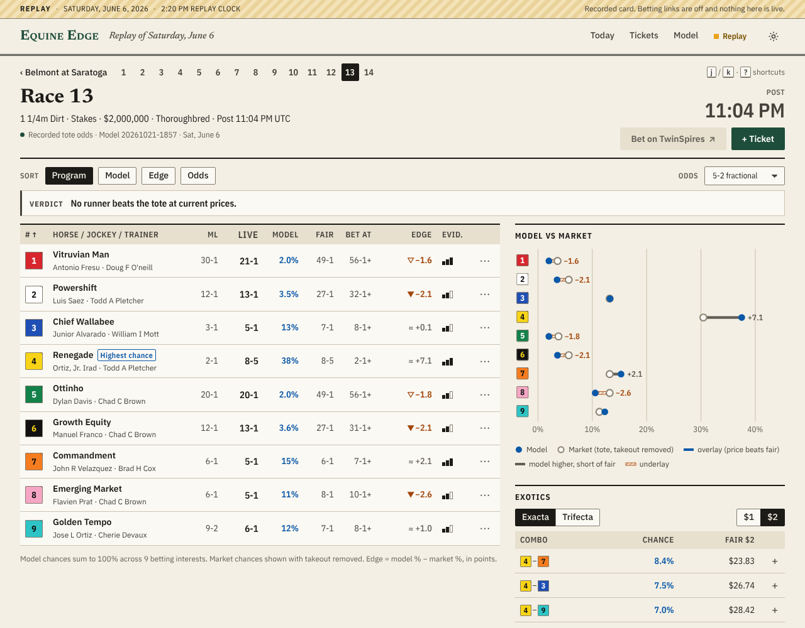

# Equine Edge v2

A race-day companion for horseplayers who bet on **TwinSpires**, at **any
track it carries**: thoroughbred, harness and quarter horse. Open the next
race anywhere and within seconds see every runner's chance of winning, the
fair price, whether the tote is offering more than that, and the most likely
exacta and trifecta combinations. Record paper tickets, and they settle
themselves when the result is official, with closing-line value.



## Why it's built this way

- **One model for every track.** A per-breed conditional logit scores each
  horse relative to its own past and today's conditions, never "how good is
  track X", so it works on a card it has never seen
  ([decisions](docs/DECISIONS.md) D-003).
- **The market is the backbone.** The tote, with takeout removed, is the
  prior. Form nudges it only as far as the evidence allows: a horse with no
  history in our data sits exactly at the market's view (D-004, D-005).
- **Coherent numbers.** Win chances sum to 100%. Place, show, exacta and
  trifecta all come from that one distribution (discounted Harville).
  Scratches and what-if scratches recompute exactly.
- **Honest about itself.** The [model card](docs/MODEL_CARD.md) and the
  in-app Model page lead with the uncomfortable fact: the form model alone
  picks fewer winners than the betting favourite. The app records pre-race
  snapshots and results so that the blend can be tested and refit against
  real outcomes (`edge calibrate`).

## Quick start

```bash
# backend (Python 3.11+)
cd v2/backend
python -m venv .venv && . .venv/bin/activate
pip install -c constraints.txt -e '.[dev]'

# web (Node 20+)
cd ../web && npm ci && npm run build

# run: replays a recorded day of real US cards by default
cd ../backend && edge serve        # → http://127.0.0.1:8765
```

Live TwinSpires:

```bash
edge ts-probe                      # first, check the endpoints from your network
EDGE_SOURCE=twinspires edge serve
```

Development: `edge serve` in one terminal and `npm run dev` in `v2/web`
(Vite on :5173 proxies `/api`).

## What's where

| | |
|---|---|
| [docs/PRODUCT.md](docs/PRODUCT.md) | users, jobs, P0 requirements, principles |
| [docs/DESIGN.md](docs/DESIGN.md) | "The Form" design system, screens, states, a11y |
| [docs/ARCHITECTURE.md](docs/ARCHITECTURE.md) | components, request path, settlement |
| [docs/DATA_SOURCES.md](docs/DATA_SOURCES.md) | TwinSpires endpoints and how to verify them, replay data, history |
| [docs/MODEL_CARD.md](docs/MODEL_CARD.md) | data, walk-forward evaluation, limits |
| [docs/DECISIONS.md](docs/DECISIONS.md) | decision log |
| [docs/PROGRESS.md](docs/PROGRESS.md) | status, test results, known issues, next steps |
| [AGENTS.md](AGENTS.md) | rules for anyone (human or AI) changing the code |

## Configuration

| Variable | Default | |
|---|---|---|
| `EDGE_SOURCE` | `archive` | `archive` (replay) or `twinspires` (live) |
| `EDGE_REPLAY_DATE` | busiest recorded day | e.g. `2026-06-05` |
| `EDGE_DB_PATH` | `v2/var/edge.sqlite3` | tickets, snapshots, results |
| `EDGE_HISTORY_PATH` | `data/processed/us_races_cleaned.parquet` | form history |
| `EDGE_TS_BASE`, `EDGE_TS_AFFID`, `EDGE_TS_ENDPOINT_*` | see DATA_SOURCES | TwinSpires endpoints |
| `EDGE_POLL` | `1` | live-mode background refresh |

## Responsible use

Equine Edge records paper tickets only and never places bets. Its numbers
are estimates with real uncertainty, not tips. If gambling stops being fun,
call 1-800-GAMBLER.
